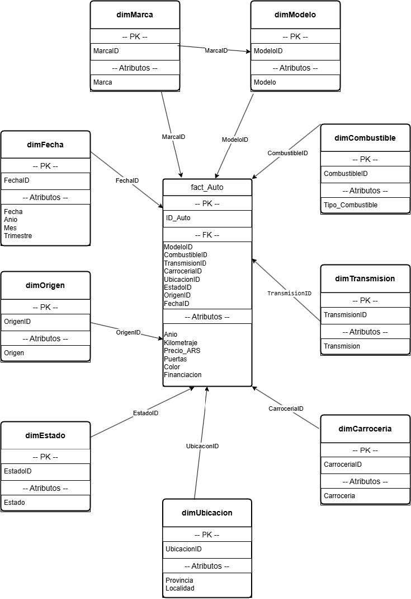

# Bases de Datos — Feria del Automóvil

Proyecto de base de datos relacional modelada en esquema estrella para una feria de compra/venta de autos. Motor MySQL 8+.

## Scripts (ejecutar en orden)

| Archivo | Descripción |
|---------|-------------|
| `sql/01_schema.sql` | Crea la base de datos, tablas dimensión, tabla de hechos y transaccionales |
| `sql/02_datos.sql` | Inserta datos de prueba en todas las tablas |
| `sql/03_objetos.sql` | Crea vistas, funciones, stored procedures y triggers |

## Cómo ejecutar

```sql
source sql/01_schema.sql
source sql/02_datos.sql
source sql/03_objetos.sql
```

## Objetos de base de datos

| Tipo | Nombre | Descripción |
|------|--------|-------------|
| Vista | `vw_autos_detalle` | Detalle completo con todas las dimensiones |
| Vista | `vw_precio_promedio_marca` | Precio promedio y cantidad por marca |
| Vista | `vw_autos_por_provincia` | Distribución geográfica |
| Vista | `vw_autos_financiados` | Autos con financiación disponible |
| Vista | `vw_ventas_por_mes` | Resumen mensual de ventas |
| Función | `fn_precio_con_financiacion` | Precio con recargo del 10% si tiene financiación |
| Función | `fn_antiguedad_auto` | Antigüedad en años del vehículo |
| Procedure | `sp_insertar_auto` | Inserta nueva publicación |
| Procedure | `sp_autos_por_marca` | Lista autos de una marca ordenados por precio |
| Procedure | `sp_actualizar_precio` | Actualiza precio de un auto |
| Trigger | `trg_validar_precio_before_insert` | Rechaza precios negativos |
| Trigger | `trg_validar_km_before_insert` | Rechaza kilometrajes negativos |
| Trigger | `trg_log_cambio_precio_after_update` | Registra cambios de precio en log |

## Diagrama


